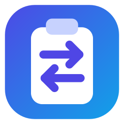
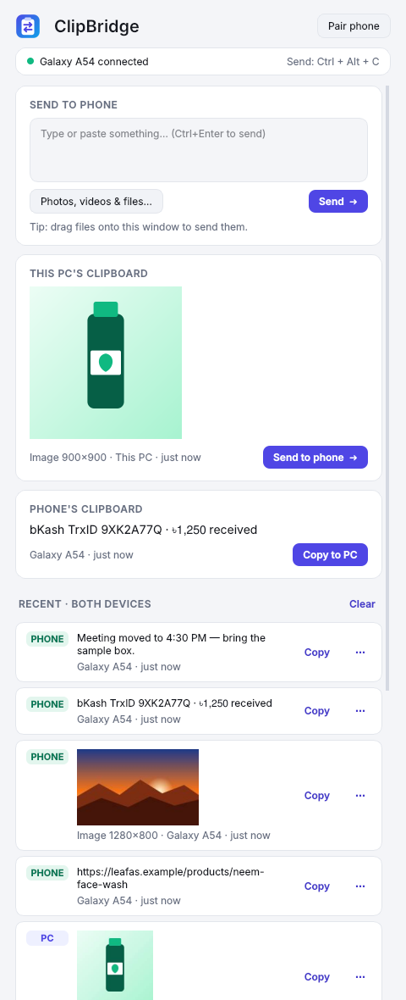
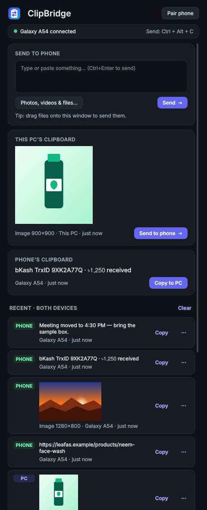
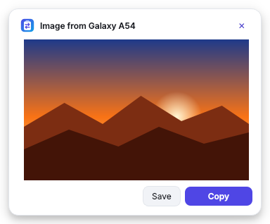
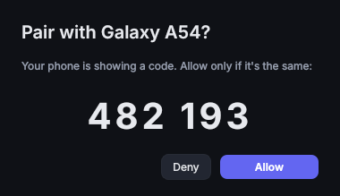

<p align="center">
  
</p>

<h1 align="center">ClipBridge</h1>

<p align="center">
  Copy on your PC, paste on your phone — and the other way round.<br>
  Text, images, photos, videos and any file. Over your own Wi-Fi, end-to-end encrypted, no cloud, no account.
</p>

<p align="center">
  <a href="https://github.com/israk404/clipbridge/actions/workflows/build.yml"></a>
  
  
  
</p>

---

## Download

| Device | Get it |
|---|---|
| Android phone | **ClipBridge.apk** from [Releases → latest](https://github.com/israk404/clipbridge/releases/latest) (also in [`downloads/`](downloads/)) |
| Windows PC | **ClipBridge.exe** from [Releases → latest](https://github.com/israk404/clipbridge/releases/latest) |

Both are built automatically from this repository on every push to `main`. New versions install over old ones and keep your pairing.

## Features

| | On the phone | On the PC |
|---|---|---|
| **Send what you copied** | *Send to PC* Quick Settings tile — text **or image** | **Ctrl + Alt + C** — text, image (e.g. a Win+Shift+S screenshot) or files copied in Explorer |
| **Get the other side's clipboard** | *Copy from PC* tile | *Copy to PC* button / tray menu |
| **Type and send** | Text box → *Send text* | Text box → *Send* (Ctrl+Enter) |
| **Photos, videos, any file** | *Photo / video* and *Any file* buttons, or **Share → Send to PC** from any app | *Photos, videos & files…* button, or **drag files onto the window** |
| **When something arrives** | Notification with **Copy** / **Open** / **Save to gallery** / **Share** | Popup with **Copy** / **Open** / **Save** / **Show in folder** |
| **Shared history** | Last 5 items from both devices + pinned items, with image thumbnails | Same list, kept on the PC |
| **Received files** | *Files* list in the app; optional auto-save to the gallery | Saved to `Downloads\ClipBridge` (changeable) |
| **Automation** | Auto-copy what the PC sends | Auto-sync every PC copy to the phone · Auto-copy from phone · Start with Windows |

Plus: one-tap **Open** for links, progress bars with **Cancel** for big transfers, and anything your password manager marks as secret is never synced.

## Screenshots

<p align="center">
  
  &nbsp;
  
</p>
<p align="center">
  
  &nbsp;
  
</p>

## Quick start

1. Install **ClipBridge.apk** on the phone and run **ClipBridge.exe** on the PC.
2. Put both on the **same Wi-Fi**, and in Windows set that network to **Private**.
3. On the PC click **Pair phone**; on the phone tap **Find my PC**.
4. Check both screens show the same 6-digit code → click **Allow** on the PC.
5. On the phone, tap **Add Quick Settings tiles** and **Allow running in background**.

Full guide, phone battery settings and troubleshooting: **[docs/SETUP.md](docs/SETUP.md)** · Everyday use: **[docs/USAGE.md](docs/USAGE.md)**

## Documentation

| Document | What's inside |
|---|---|
| [docs/SETUP.md](docs/SETUP.md) | Install, connect, firewall, phone battery settings, Tailscale, troubleshooting |
| [docs/USAGE.md](docs/USAGE.md) | Every way to send and receive text, images and files |
| [docs/HOW-IT-WORKS.md](docs/HOW-IT-WORKS.md) | Architecture, wire protocol and security model |
| [windows/README.md](windows/README.md) | Run, test and build the Windows app |
| [android/README.md](android/README.md) | Build the Android app |
| [CHANGELOG.md](CHANGELOG.md) | What changed in each version |

## Repository layout

```
clipbridge/
├── android/                     Android app (Kotlin, framework APIs only)
│   ├── app/
│   │   ├── src/main/java/…      source code
│   │   ├── src/main/res/        icons, themes
│   │   └── build.gradle.kts     (signing key comes from GitHub secrets)
│   └── protocol-test/           runs the phone's network code against the real PC app
├── windows/                     Windows app (Python 3.10+, PySide6)
│   ├── clipbridge/              source code
│   ├── tests/                   end-to-end tests + screenshot generator
│   ├── assets/                  app icon
│   ├── build_exe.bat            build ClipBridge.exe locally
│   └── run.bat                  run from source
├── docs/                        guides, screenshots, logo
├── downloads/                   ready-to-install ClipBridge.apk
└── .github/workflows/build.yml  CI: tests → APK + EXE → Releases
```

## Privacy & security

Everything stays on your own network — there is no server. Pairing uses an ECDH key exchange confirmed with a 6-digit code on both screens, and every message and file is encrypted with AES-256-GCM. Details in [docs/HOW-IT-WORKS.md](docs/HOW-IT-WORKS.md).
